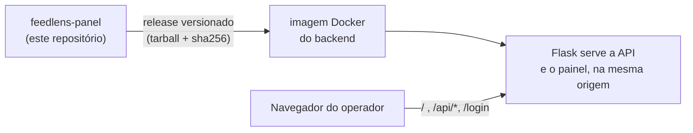

# FeedLens · painel

Painel do [FeedLens](https://github.com/IannCarvalho/feedlens), a plataforma que analisa feedbacks de clientes com IA. É o front de quem **opera** o produto: visão geral com gráficos, lista e detalhe dos feedbacks (corrigir sentimento, marcar spam, reanalisar) e o cofre de chaves dos provedores de IA.

Vue 3 + Vite + PrimeVue + Pinia, em TypeScript. O formulário que o cliente final usa para enviar feedback é outro projeto: [feedlens-form](https://github.com/IannCarvalho/feedlens-form).

## Como se encaixa



O painel **não tem servidor próprio em produção**. Cada release é um tarball do build que o backend ([feedlens](https://github.com/IannCarvalho/feedlens)) embute na imagem e serve em `/`. Isso mantém painel e API na mesma origem, de modo que o cookie de sessão e o CSRF funcionam sem CORS com credenciais.

Consequência importante: o `base` do Vite é `/static/spa/` e **precisa casar com a rota do Flask que serve os assets**. Não o altere sem alterar o backend. O script de empacotamento falha se o `index.html` não referenciar `/static/spa/assets/`.

## Rodando em desenvolvimento

Pré-requisitos: Node 24.15 ou superior (veja `.node-version`; com `fnm`, rode `fnm use`) e o backend rodando em `http://127.0.0.1:5000`. Para subir o backend, siga o [README do feedlens](https://github.com/IannCarvalho/feedlens/blob/main/README.md).

```powershell
npm ci
npm run dev        # http://localhost:5173
```

O Vite encaminha `/api`, `/auth`, `/login`, `/logout` e `/health` para o Flask, então o navegador enxerga uma origem só. Se o backend estiver em outro endereço:

```powershell
$env:FEEDLENS_API_URL = "http://127.0.0.1:5001"
npm run dev
```

Entre com a senha definida em `DASHBOARD_PASSWORD` no `.env` do backend.

## Comandos

| Comando | O que faz |
|---|---|
| `npm run dev` | Servidor de desenvolvimento com proxy para o Flask |
| `npm run typecheck` | Checagem de tipos (`vue-tsc`) |
| `npm run lint` | ESLint, sem tolerância a warnings |
| `npm run build` | Typecheck + build de produção em `dist/` |
| `npm run preview` | Serve o `dist/` localmente (sem API) |
| `bash scripts/package.sh` | Empacota `dist/` em `release/` (tarball + checksum) |

## Variáveis de ambiente

| Variável | Onde | Padrão | Uso |
|---|---|---|---|
| `FEEDLENS_API_URL` | Só em `npm run dev` | `http://127.0.0.1:5000` | Para onde o proxy do Vite encaminha a API |

O build de produção **não lê variáveis de ambiente**: tudo é relativo à origem que serve o painel.

## Releases

O CI (`.github/workflows/ci.yml`) roda typecheck, lint e build a cada PR, e ainda empacota o tarball como ensaio, guardando-o como artefato do run.

Para publicar uma versão:

1. Ajuste `version` em `package.json` e faça merge.
2. Crie e envie a tag: `git tag v0.1.0` e `git push origin v0.1.0`.

O workflow `release.yml` confere que a tag bate com o `package.json`, compila e cria o release com dois arquivos:

- `feedlens-panel-v<versão>.tgz`: o conteúdo de `dist/` na raiz do tarball;
- `feedlens-panel-v<versão>.tgz.sha256`: checksum no formato do `sha256sum -c`.

O empacotamento é determinístico (ordem, datas e dono fixos): o mesmo build, no mesmo ambiente, gera o mesmo checksum. O checksum que vale é o do release, gerado no runner Linux do GitHub Actions. Um build local no Windows gera outro, porque o Git converte o fim de linha dos fontes; use o `.sha256` do release, não um calculado localmente.

### Como o backend consome o release

O `Dockerfile` do [feedlens](https://github.com/IannCarvalho/feedlens) fixa a versão e o checksum do painel e baixa o release com `ADD --checksum` (o build falha se o arquivo não for exatamente o esperado):

```dockerfile
ARG PANEL_VERSION=0.1.0
ARG PANEL_SHA256=<conteúdo do .sha256 do release>

FROM alpine:3.21 AS panel
ARG PANEL_VERSION
ARG PANEL_SHA256
ADD --checksum=sha256:${PANEL_SHA256} \
    https://github.com/IannCarvalho/feedlens-panel/releases/download/v${PANEL_VERSION}/feedlens-panel-v${PANEL_VERSION}.tgz \
    /tmp/panel.tgz
RUN mkdir /spa && tar -xzf /tmp/panel.tgz -C /spa
```

O tarball é extraído em `app/static/spa/` da imagem final. Para desenvolver só o backend, o feedlens traz `scripts/fetch_panel.py`, que faz o mesmo download com a mesma conferência. Quando sai um release novo, o workflow `panel-bump.yml` do feedlens abre sozinho o PR que sobe a versão (ele nunca faz merge).

## Compatibilidade com a API

| Painel | Backend (feedlens) |
|---|---|
| v0.1.x | a partir do commit `e2d3b69` (inclui edição de modelo e chave no cofre, correção de sentimento e spam, e o campo `unanalyzed` de `/api/stats`) |
| v0.2.x | a partir do commit `a2f11f6` (acrescenta o endpoint `POST /api/feedbacks/reanalyze-pending`, usado pelo botão "Reanalisar todos os não analisados") |
| v0.2.1 | mesmo requisito do v0.2.x; só traduz o `last_error_kind` da chave salva ("auth" → "chave recusada", "not_found" → "modelo indisponível") |

O backend ainda não tem versões. Ao publicar um painel que dependa de uma resposta nova da API, faça o PR do backend primeiro (compatível com o painel anterior), e registre aqui o commit mínimo.

### Reanalisar todos os não analisados

O botão "Reanalisar todos os não analisados" (na Visão geral e na lista de feedbacks, junto do aviso de não analisados) depende de um endpoint novo do backend. **Essa funcionalidade só funciona com a versão do backend que já traz esse endpoint**; sem ele, o botão aparece mas a reanálise em lote falha com uma mensagem de erro.

Requisito: o backend ([feedlens](https://github.com/IannCarvalho/feedlens)) precisa estar com o PR correspondente mergeado (o que acrescenta a reanálise em lote dos feedbacks pendentes). Publique e mergeie o backend **antes** de lançar um release do painel que inclua este botão. O commit mínimo do backend é `a2f11f6` (`a2f11f6d0e07875408806a11577e693ac09110f3`, PR [#62](https://github.com/IannCarvalho/feedlens/pull/62)), que introduz o endpoint `POST /api/feedbacks/reanalyze-pending`; veja a tabela de compatibilidade acima.

## Estrutura

```
src/main.ts, App.vue     entrada e casca (menu, tema)
src/router/              rotas (Vue Router em history mode, base "/")
src/stores/              Pinia: sessão, estatísticas, feedbacks, provedores
src/views/               Dashboard, lista e detalhe, provedores, login
src/components/          gráficos e marca
src/theme/, assets/      tema do PrimeVue e CSS
src/lib/                 cliente HTTP, rótulos de sentimento e de análise
src/types/api.ts         tipos das respostas da API do backend (escritos à mão; fonte do app)
src/types/api.generated.ts  tipos gerados do contrato OpenAPI (gerado, não edite)
src/types/api.contract.ts   checagem só-de-tipos: gerado × escrito à mão (não roda no app)
api-spec.version         SHA do backend ao qual a spec OpenAPI está fixada
scripts/gen-api-types.mjs  gera api.generated.ts (npm run gen:api)
scripts/package.sh       empacota dist/ para o release
```

## Contrato com a API

`src/types/api.ts` espelha, **à mão**, as respostas do backend. Esse arquivo **segue sendo a fonte que o app usa**: views e stores importam dele. Quando uma mudança do backend altera uma resposta, ele precisa mudar junto, em um PR aqui.

Para não deixar esse espelho divergir do backend em silêncio, o painel também **gera** tipos a partir do contrato OpenAPI do backend ([feedlens](https://github.com/IannCarvalho/feedlens), arquivo `openapi.yaml`) e confere, só em tempo de compilação, que as respostas geradas cabem nos tipos escritos à mão. Migrar o app para consumir os tipos gerados é uma decisão futura; por ora os dois coexistem.

### Regenerar os tipos do contrato

```powershell
npm run gen:api
```

Isso lê a spec OpenAPI do backend — **fixada a um commit** no arquivo `api-spec.version` (na raiz) — e grava `src/types/api.generated.ts` (arquivo commitado, com cabeçalho "gerado, não edite"). O script é Node puro (não precisa de `bash`/`curl`) e é idempotente: rodar duas vezes gera exatamente o mesmo arquivo.

A checagem de compatibilidade vive em `src/types/api.contract.ts` — um arquivo **só de tipos, não importado pelo app**, que o `npm run typecheck` usa para falhar se os tipos gerados deixarem de ser atribuíveis aos escritos à mão. Diferenças de forma já conhecidas e aceitas estão documentadas lá; se o backend introduzir **outra** divergência, o typecheck quebra em vez de passar despercebido.

**Quando o backend mudar o contrato:** suba o SHA em `api-spec.version` para o novo commit do backend, rode `npm run gen:api` e commite o `src/types/api.generated.ts` resultante. O CI regenera e falha se o arquivo commitado estiver diferente da spec fixada — ou seja, o SHA fixado e o arquivo gerado têm de contar a mesma história.

## Histórico

Este repositório nasceu da pasta `frontend/` do [feedlens](https://github.com/IannCarvalho/feedlens), com o histórico de git preservado (`git filter-repo`). Referências como `IannCarvalho/feedlens#54` nas mensagens de commit apontam para PRs do repositório original.

## Licença

[MIT](LICENSE)
